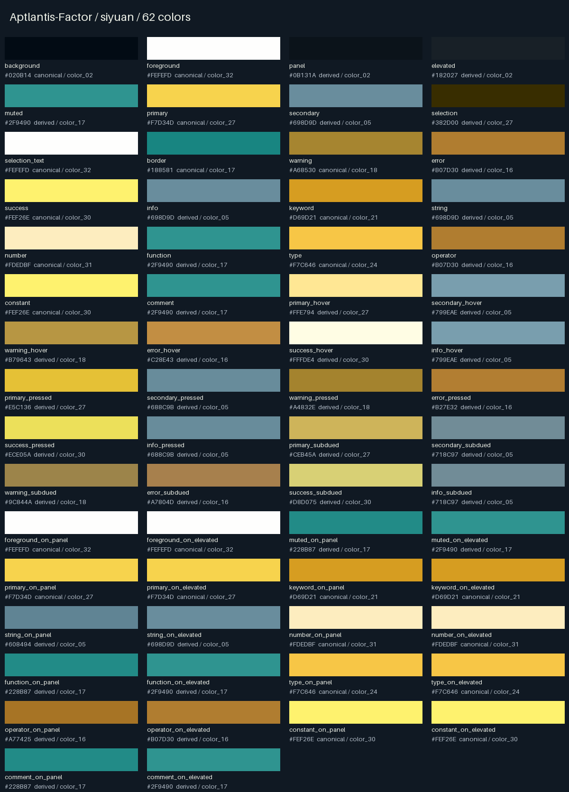
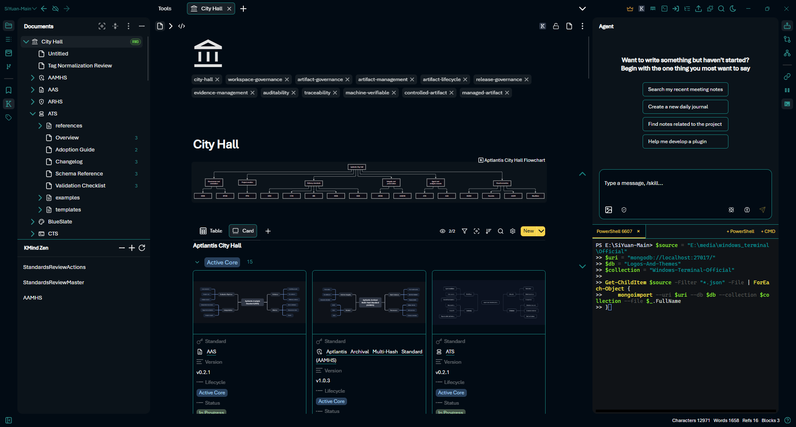
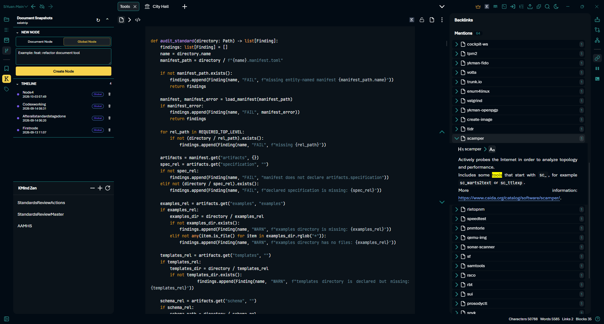
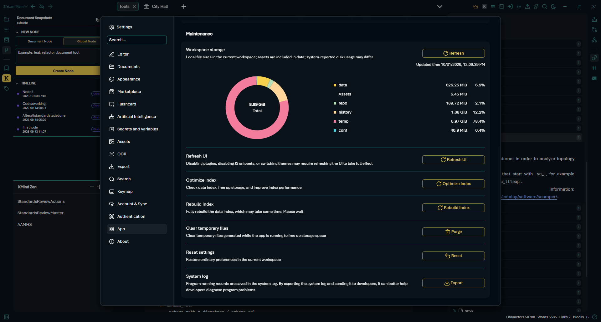

# Aptlantis-Factor

A dark SiYuan theme with #020B14 backgrounds, #F7D34D primary accents, and #FEFEFD text, derived from the supplied Factor palette.

## Palette

| Role | Color |
| --- | --- |
| Background | `#020B14` |
| Foreground | `#FEFEFD` |
| Panel | `#0B131A` |
| Elevated | `#182027` |
| Primary | `#F7D34D` |
| Secondary | `#698D9D` |
| Border | `#188581` |
| Success | `#FEF26E` |
| Warning | `#A68530` |
| Error | `#B07D30` |

[Download the palette TOML](assets/apt-factor-siyuan-palette.toml)

## SiYuan screenshots

## Package and source material

| File | Purpose |
| --- | --- |
| `theme.css` | Theme colors and SiYuan styling. |
| `theme.json` | Package identity and compatibility declarations. |
| `logo.png` | Supplied 1024×768 branding card. |
| `preview.png` | The same card for the marketplace preview. |
| `icon.png` | A 160×160 derivative of the supplied logo. |
| `assets/` | Palette TOML, swatch, and available screenshots used here. |
| `License` | MIT No Attribution license text. |

Original artwork and pipeline outputs are retained in the collection's `factor-refs/` folder. The palette and swatch above are copies of those supplied outputs. Pipeline reports describe their original generation run; they do not establish current runtime acceptance.

## Installation and compatibility

Install the contents of `package/` into the theme directory named `apt-factor` in your SiYuan workspace's appearance themes location, then select it in Appearance settings. Use the location documented for your installed SiYuan version. Restart SiYuan after replacing an installed theme before evaluating cached assets.

- Package version: `0.1.0`.
- Declared minimum SiYuan version: `3.7.0`.
- Declared modes: dark. Declared frontends: all.
- Source artwork is complete.
- Native SiYuan rendering and installation were not tested during this organization pass. Supplied screenshots are reference captures; their app version and capture procedure are not established here.

## License

[MIT No Attribution](License). Copyright 2026 Herb Schumann.
